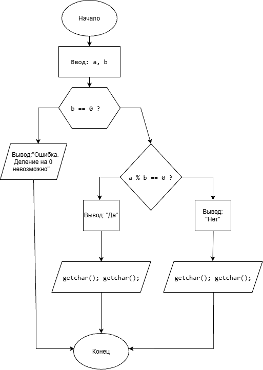

# Лабораторная работа N6
## Домашнее задание
Написать программу, которая отвечает на вопрос (сообщение типа "Да"/"Нет") делятся ли введенные пользователем числа нацело
### Алгоритм и блок-схема
### Алгоритм
1. Начало
2. Объявление переменных
3. Составления условия и программы
4. Конец
### Блок-схема

## Реализация программы
```c
#define _CRT_SECURE_NO_WARNINGS
#include <stdio.h>
#include <math.h>
#include <locale.h>

int main() {
    setlocale(LC_ALL, "Russian");
    int year;
    printf("Введите год: ");
    if (scanf("%d", &year) != 1) return 1;
    if ((year % 4 == 0 && year % 100 != 0) || (year % 400 == 0)) {
        // (кратен 4 И НЕ кратен 100) ИЛИ (кратен 400)
        printf("год %d високосный\n", year);
    }
    else {
        printf("год %d не високосный\n", year);
    }

    printf("\n");

    double x, result;
    printf("Введите значение x: ");
    if (scanf("%lf", &x) != 1) return 1;
    printf("При x = %.2lf, F(x) = %.4lf\n", x,
        (x > 3.6) ? ((45 * x * x + 5) / (5 * x)) : ((10 * x * x + 1) / x));
    printf("\n");

    int a, b;
    printf("Введите два целых числа (делимое и делитель): ");

    // Убираем проверку на != 2, оставляем просто чтение
    scanf("%d %d", &a, &b);

    if (b == 0) {
        printf("Ошибка: деление на ноль невозможно.\n");
    }
    else {
        if (a % b == 0) {
            printf("Да\n");
        }
        else {
            printf("Нет\n");
        }
    }

    printf("\nНажмите Enter для выхода...");
    getchar(); 
    getchar(); 

    return 0;
}
